# Whole-genome comparison of *Bacteroides fragilis* CCUG4856 against NCTC9343

**Query** — *B. fragilis* CCUG4856 (`GCF_005706655.1`, `NZ_CP036555.1` + `NZ_CP036556.1`)  
**Reference** — *B. fragilis* NCTC9343 (`GCF_000025985.1`, `NC_003228.3` + `NC_006873.1`)  
**Generated** — 2026-10-12 17:48  
**Pipeline** — `WGS.sh`, conda environment `WGS`  

## 1. Executive summary

The two genomes are extraordinarily close. Along a single collinear alignment covering **100 %** of both replicons at **99.99 %** average identity, the analysis accepts **4 single-site differences** (1 SNP, 2 insertion, 1 deletion) plus **one large structural rearrangement**.

1. **An 88,340 bp inversion** at `NC_003228.3:2005600–2093939` — the segment is present in the query in the opposite orientation (verified with a perfect 88,340 bp reverse-complement alignment).
2. `NC_003228.3:530487` **G → GT** (INS); supported by 2 independent methods.
3. `NC_003228.3:669715` **TTA → T** (DEL); supported by 2 independent methods.
4. `NC_003228.3:683862` **G → A** (SNP); supported by 3 independent methods.
5. `NC_003228.3:1709303` **G → GT** (INS); supported by 2 independent methods.

**3 genes** carry a different protein product and are each explained by one of the verified variants. The most consequential finding is that the query **restores the reading frame of 2 gene(s) that the reference annotation records as pseudogenes**:

* `BF9343_RS02095` — BamA/OMP85 family outer membrane protein — query_ORF_restored
* `BF9343_RS02670` — RagB/SusD family nutrient uptake outer membrane protein — intact_in_both
* `BF9343_RS06655` — FtsX-like permease family protein — query_ORF_restored

A further **2 gene(s)** show a different projected protein but are **not** backed by a confident variant — each sits in a multi-copy repeat or at a rearrangement breakpoint where the alignment cannot decide which paralogue is which. They are listed for completeness and must not be reported as differences:

* `BF9343_RS10095` — IS30 family transposase (projected fraction 1.000)
* `BF9343_RS11555` — BACON domain-containing protein (projected fraction 0.934)

> **Coordinate convention, not biology.** The query chromosome is the reference chromosome **re-linearised at a different origin** (offset 936212 bp, covering 98.29 % of the reference). A naive position-by-position comparison would report this as ~100 % of the genome differing. It is a property of how the two assemblies were deposited, and the alignment-based analysis here is immune to it.

## 2. Data and quality control

### 2.1 Assembly quality

| metric | reference NCTC9343 | query CCUG4856 |
|---|---|---|
| total length (bp) | 5,241,700 | 5,241,693 |
| contigs | 2 | 2 |
| N50 (bp) | 5,205,140 | 5,205,133 |
| largest contig (bp) | 5,205,140 | 5,205,133 |
| GC (%) | 43.11 | 43.11 |
| ambiguous bases | 0 | 0 |
| assembly level | Complete Genome | Complete Genome |

Reference-based QUAST report (query vs reference):

| Assembly | query |
|---|---|
| # contigs (>= 0 bp) | 2 |
| # contigs (>= 1000 bp) | 2 |
| # contigs (>= 5000 bp) | 2 |
| # contigs (>= 10000 bp) | 2 |
| # contigs (>= 25000 bp) | 2 |
| # contigs (>= 50000 bp) | 1 |
| Total length (>= 0 bp) | 5241693 |
| Total length (>= 1000 bp) | 5241693 |
| Total length (>= 5000 bp) | 5241693 |
| Total length (>= 10000 bp) | 5241693 |
| Total length (>= 25000 bp) | 5241693 |
| Total length (>= 50000 bp) | 5205133 |
| # contigs | 2 |
| Largest contig | 5205133 |
| Total length | 5241693 |
| Reference length | 5241700 |
| GC (%) | 43.11 |
| Reference GC (%) | 43.11 |
| N50 | 5205133 |
| NG50 | 5205133 |
| N90 | 5205133 |
| NG90 | 5205133 |
| auN | 5169083.0 |
| auNG | 5169076.1 |
| L50 | 1 |
| LG50 | 1 |
| L90 | 1 |
| LG90 | 1 |
| # misassemblies | 2 |
| # misassembled contigs | 1 |
| _… 24 more rows in the TSV_ | |

QUAST single-assembly reports are in `01_qc/quast/reference_report.txt` and `01_qc/quast/query_report.txt`.

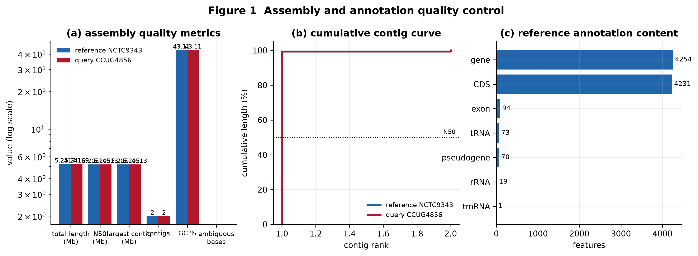

### 2.2 Read-level QC of the in-silico reads

The query is a **finished assembly**, so no wet-lab reads exist for it. To provide a genuine read-level QC layer and, more importantly, an *independent* check of the assembly-derived variant calls, Illumina reads were simulated from the query assembly (~100× coverage, 150 bp, 350 bp insert) with `wgsim` at a 0.5 % base error rate. **Everything derived from these reads is labelled `SIM` and is used only as confirmation, never as primary evidence.**

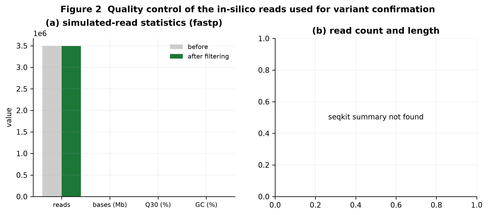

## 3. Genome alignment

### 3.1 Whole-genome alignment

```
/home/cz/WGS/reference/unzipped/reference.fna /home/cz/WGS/seq/unzipped/query.fna
NUCMER

                               [REF]                [QRY]
[Sequences]
TotalSeqs                          2                    2
AlignedSeqs              2(100.0000%)          2(100.0000%)
UnalignedSeqs             0(0.0000%)           0(0.0000%)

[Bases]
TotalBases                   5241700              5241693
AlignedBases       5241700(100.0000%)    5241693(100.0000%)
UnalignedBases            0(0.0000%)           0(0.0000%)

[Alignments]
1-to-1                            10                   10
TotalLength                  5242730              5242723
AvgLength                524273.0000          524272.3000
AvgIdentity                  99.9899              99.9899

M-to-M                            10                   10
TotalLength                  5242730              5242723
AvgLength                524273.0000          524272.3000
AvgIdentity                  99.9899              99.9899

[Feature Estimates]
Breakpoints                       16                   16
Relocations                        2                    2
Translocations                     0                    0
Inversions                         6                    6

Insertions                         0                    0
InsertionSum                       0                    0
InsertionAvg                  0.0000               0.0000

TandemIns                          0                    0
TandemInsSum                       0                    0
TandemInsAvg                  0.0000               0.0000

[SNPs]
TotalSNPs                         26                   26
GC                        0(0.0000%)           0(0.0000%)
GT                       3(11.5385%)           2(7.6923%)
GA                        1(3.8462%)          9(34.6154%)
CA                       3(11.5385%)           1(3.8462%)
CT                       4(15.3846%)           2(7.6923%)
CG                        0(0.0000%)           0(0.0000%)
TG                        2(7.6923%)          3(11.5385%)
TC                        2(7.6923%)          4(15.3846%)
TA                        0(0.0000%)           1(3.8462%)
AG                       9(34.6154%)           1(3.8462%)
AC                        1(3.8462%)          3(11.5385%)
AT                        1(3.8462%)           0(0.0000%)

TotalGSNPs                         6                    6
AT                        0(0.0000%)           0(0.0000%)
AC                        0(0.0000%)           0(0.0000%)
AG                       1(16.6667%)          1(16.6667%)
GA                       1(16.6667%)          1(16.6667%)
GC                        0(0.0000%)           0(0.0000%)
GT                        0(0.0000%)           0(0.0000%)
CA                        0(0.0000%)           0(0.0000%)
CG                        0(0.0000%)           0(0.0000%)
CT                       3(50.0000%)          1(16.6667%)
TG                        0(0.0000%)           0(0.0000%)
TC                       1(16.6667%)          3(50.0000%)
TA                        0(0.0000%)           0(0.0000%)

TotalIndels                       19                   19
G.                       2(10.5263%)           0(0.0000%)
C.                       2(10.5263%)          4(21.0526%)
T.                       3(15.7895%)          2(10.5263%)
A.                       6(31.5789%)           0(0.0000%)
.A                        0(0.0000%)          6(31.5789%)
.T                       2(10.5263%)          3(15.7895%)
.G                        0(0.0000%)          2(10.5263%)
.C                       4(21.0526%)          2(10.5263%)

TotalGIndels                       3                    3
A.                        0(0.0000%)           0(0.0000%)
G.                        0(0.0000%)           0(0.0000%)
C.                        0(0.0000%)           0(0.0000%)
T.                       1(33.3333%)          2(66.6667%)
.C                        0(0.0000%)           0(0.0000%)
.G                        0(0.0000%)           0(0.0000%)
.T                       2(66.6667%)          1(33.3333%)
.A                        0(0.0000%)           0(0.0000%)
```

Method: `nucmer --maxmatch` followed by `delta-filter -1` for the 1-to-1 alignment, plus `minimap2 -x asm5 --eqx` for a reference-anchored BAM. The two whole-genome alignments agree.

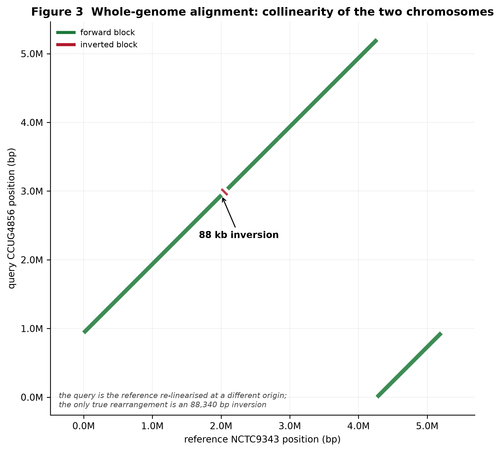

### 3.2 Structural differences

**Origin shift (coordinate convention).**

| ref_contig | ref_length | dominant_offset_bp | pct_reference_bp_at_dominant_offset | origin_shifted | interpretation |
|---|---|---|---|---|---|
| NC_003228.3 | 5205140 | 936212 | 98.29 | True | query sequence is re-linearised (rotated): reference position 1 corresponds to query position 936,212 of 5,205,133 bp.   |

**Rearrangements.**

| type | ref_contig | ref_start | ref_end | qry_start | qry_end | length_bp | identity_pct | forward_copy_elsewhere |
|---|---|---|---|---|---|---|---|---|
| inversion | NC_003228.3 | 2005600 | 2093939 | 3030148 | 2941809 | 88340 | 100.0 | False |
| whole_replicon_reverse_orientation | NC_006873.1 | 5151 | 36560 | 36560 | 5151 | 31410 | 100.0 | False |
| small_reverse_block | NC_006873.1 | 1 | 5150 | 5150 | 1 | 5150 | 100.0 | False |
| small_reverse_block | NC_003228.3 | 2831958 | 2833449 | 3769658 | 3768167 | 1492 | 100.0 | False |

The `forward_copy_elsewhere` column records whether a genuine inverted repeat (the segment present in both orientations) could explain a reverse block; for the 88 kb inversion it is `False`, and an independent `minimap2 -x asm5 --eqx` run reports a single perfect `88,340=` reverse-complement match with no forward copy — so the inversion is real and not a repeat artefact.

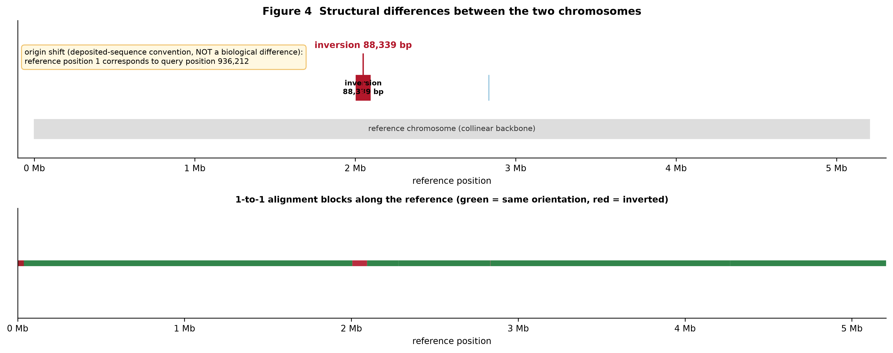

### 3.3 Coverage

| contig | length_bp | mean_depth | median_depth | max_depth | breadth_ge1x_percent | breadth_ge5x_percent | breadth_ge10x_percent | uncovered_bp | uncovered_percent | n_uncovered_regions | longest_uncovered_bp |
|---|---|---|---|---|---|---|---|---|---|---|---|
| NC_003228.3 | 5205140 | 1.00 | 1.0 | 2 | 100.00 | 0.00 | 0.00 | 114 | 0.002 | 7 | 45 |
| NC_006873.1 | 36560 | 1.00 | 1.0 | 1 | 100.00 | 0.00 | 0.00 | 0 | 0.000 | 0 | 0 |

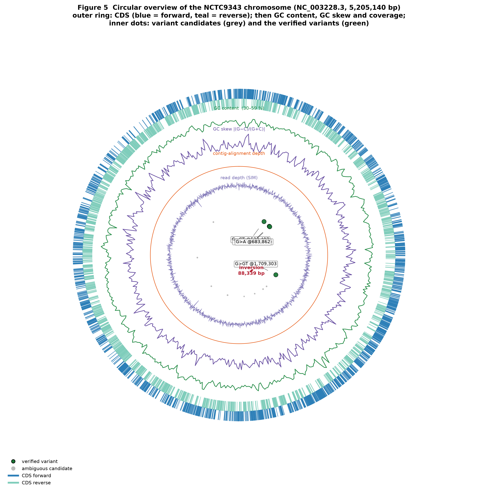

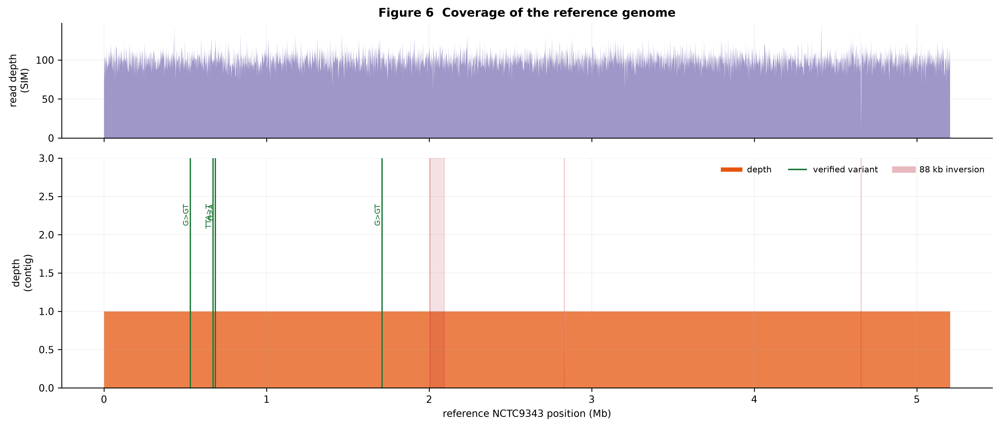

## 4. Variant detection

### 4.1 Strategy

Four independent calling routes were run and then reconciled:

| route | evidence | tool |
|---|---|---|
| `mummer` | assembly-to-assembly alignment | MUMmer `show-snps` on the 1-to-1 delta |
| `bcftools_asm` | contig alignment (minimap2 asm5) | `bcftools mpileup` + `call --ploidy 1` |
| `freebayes_asm` | contig alignment | `freebayes -p 1` |
| `bcftools_sim_*`, `freebayes_sim` | simulated reads | `bcftools` / `freebayes` |

`bcftools_asm` and `freebayes_asm` share one alignment, so their agreement is **not** independent evidence. A call is only accepted when at least two of the three genuinely independent *methods* (NUCmer alignment, contig alignment, read alignment) support it **and** no ambiguity flag is raised. Ambiguity flags are: the reference position is covered by more than one genomic copy; the NUCmer alignment reports overlapping alternative alignments; the reads covering the position map with low confidence; or the reads simply contradict the call (the alternate allele is largely absent).

**223 candidate positions** were generated; **4** survive every filter.

| metric | value |
|---|---|
| total_distinct_variants | 223 |
| high_confidence | 4 |
| medium_confidence | 0 |
| low_confidence | 219 |
| SNPs | 166 |
| insertions | 18 |
| deletions | 34 |
| MNV | 5 |
| mummer_raw_calls | 203 |


Calls per route:

| route | calls |
|---|---|
| mummer | 199 |
| bcftools_asm | 35 |
| freebayes_asm | 31 |
| bcftools_sim_indel | 4 |
| bcftools_sim_snp | 1 |
| freebayes_sim | 4 |

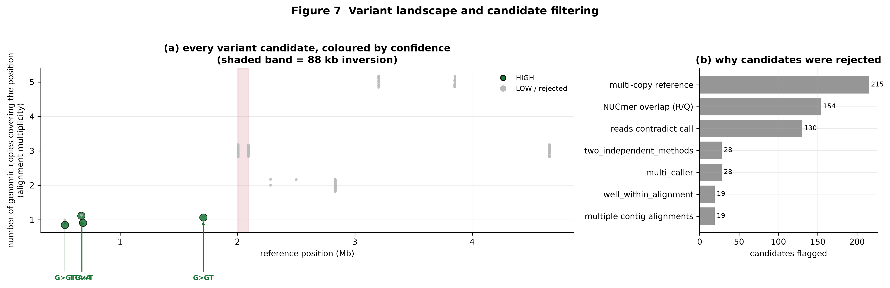

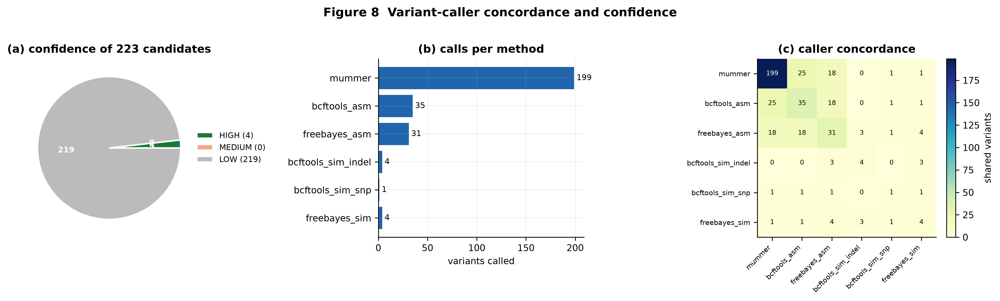

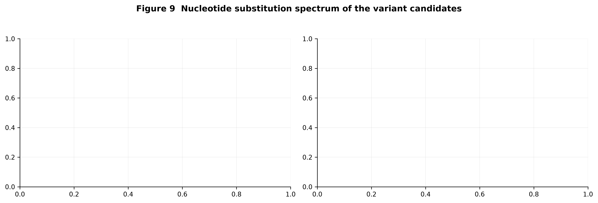

### 4.2 The verified variant set

| contig | pos | ref | alt | type | n_independent_methods | callers | obs_depth | obs_alt_frac | flags |
|---|---|---|---|---|---|---|---|---|---|
| NC_003228.3 | 530487 | G | GT | INS | 2 | bcftools_sim_indel;freebayes_asm;freebayes_sim;mummer | 86 |  | two_independent_methods;multi_caller;read_confirmed |
| NC_003228.3 | 669715 | TTA | T | DEL | 2 | bcftools_sim_indel;freebayes_asm;freebayes_sim;mummer | 93 |  | two_independent_methods;multi_caller;read_confirmed |
| NC_003228.3 | 683862 | G | A | SNP | 3 | bcftools_asm;bcftools_sim_snp;freebayes_asm;freebayes_sim;mummer | 112 | 100.0 | two_independent_methods;multi_caller;read_confirmed;two_assembly_callers;well_within_alignment |
| NC_003228.3 | 1709303 | G | GT | INS | 2 | bcftools_sim_indel;freebayes_asm;freebayes_sim;mummer | 97 |  | two_independent_methods;multi_caller;read_confirmed |

`obs_depth` / `obs_alt_frac` are the read depth at the position (from the simulated reads, mapped with MAPQ ≥ 20) and the percentage of those reads carrying the alternate allele. For a genuine homozygous difference between two haploid genomes this should be close to 100 %; the one SNP scores 100.0 %.

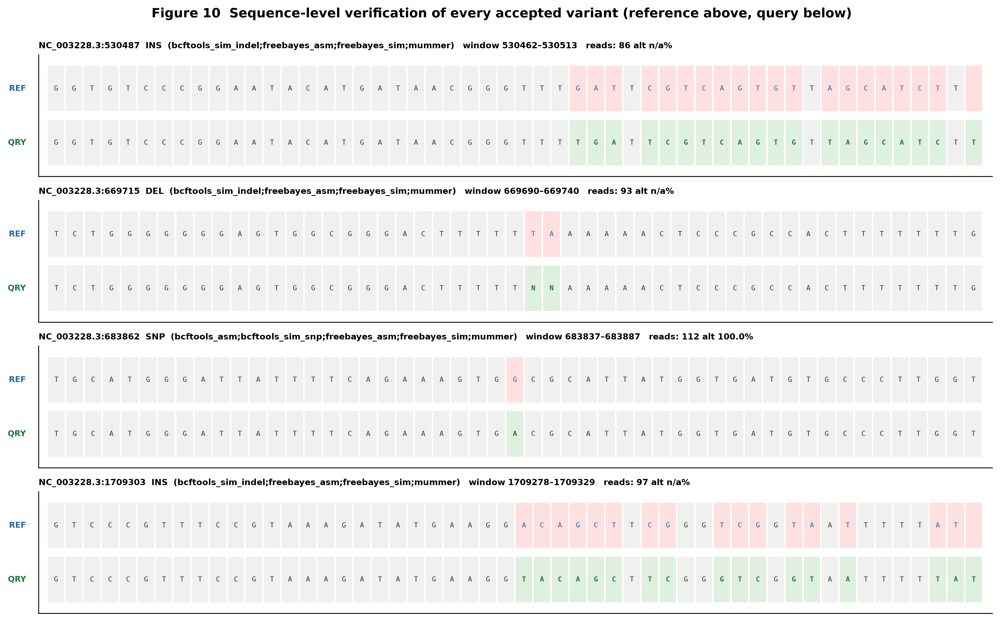

Because gap placement inside homopolymer / short-tandem runs is ambiguous, the aligner's first guess is not necessarily the biologically accurate description. The figure above reconstructs both alleles from the alignment, which resolves the indels to: an extra **T** in a T-run (`530,487`), a 2 bp **T+A** deletion in a T₆A₆ run (`669,715`), and an extra **T** at `1,709,303`.

## 5. Functional consequence

### 5.1 Annotation

A complete query annotation was produced **by projecting every reference gene through the alignment** (query coordinates *and* query sequence). At this level of identity this is more reliable than de-novo gene calling: the reference carries a curated RefSeq annotation and the two genomes are collinear. De-novo annotation with Prokka/Bakta was attempted as well; the Bakta database download was blocked in this environment, so the projection route is the operative one.

| metric | value |
|---|---|
| reference_CDS | 4231 |
| projected_and_written | 4231 |
| identical_protein | 4226 |
| protein_differs | 5 |
| query_ORF_restored | 2 |
| query_ORF_disrupted | 0 |
| sequence_differs_but_intact_in_both | 3 |
| disrupted_in_both | 0 |
| partial_projection | 0 |
| non_coding_transferred | 94 |
| min_projection_fraction | 0.9 |


### 5.2 Affected genes

| locus_tag | product | reference_gene_status | worst_effect | worst_impact | protein_change | cds_identity | ref_protein_len | qry_protein_len | ref_internal_stops | qry_internal_stops | query_orf_status |
|---|---|---|---|---|---|---|---|---|---|---|---|
| BF9343_RS02095 | BamA/OMP85 family outer membrane protein | pseudogene | frameshift_variant | HIGH |  |  | 878 | 878 | 55 | 0 | query_ORF_restored |
| BF9343_RS02670 | RagB/SusD family nutrient uptake outer membrane protein | protein_coding | missense_variant | MODERATE | p.A141T | 99.8 | 522 | 522 | 0 | 0 | intact_in_both |
| BF9343_RS06655 | FtsX-like permease family protein | pseudogene | frameshift_variant | HIGH |  |  | 416 | 416 | 15 | 0 | query_ORF_restored |

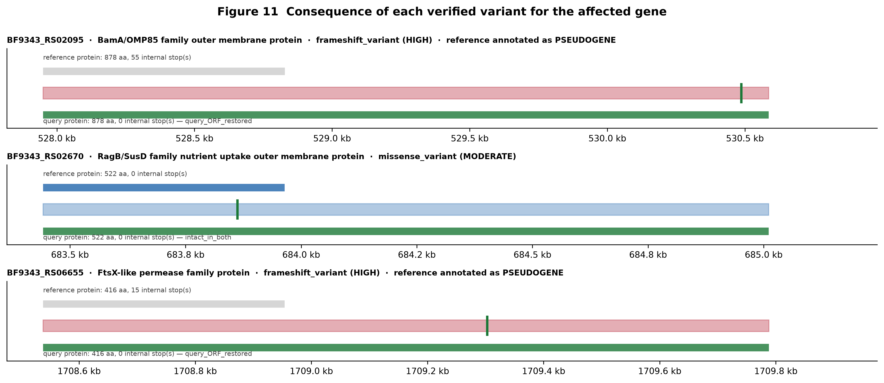

### 5.3 Genes with a different protein product

**Explained by a verified variant (3):**

| locus_tag | product | ref_contig | ref_start | ref_end | qry_contig | qry_start | qry_end | projected_fraction | ref_protein_len | qry_protein_len | query_internal_stops | ref_internal_stops | orf_status |
|---|---|---|---|---|---|---|---|---|---|---|---|---|---|
| BF9343_RS02095 | BamA/OMP85 family outer membrane protein | NC_003228.3 | 527950 | 530585 | NZ_CP036555.1 | 1464159 | 1466794 | 1.000 | 878 | 878 | 0 | 55 | query_ORF_restored |
| BF9343_RS02670 | RagB/SusD family nutrient uptake outer membrane protein | NC_003228.3 | 683442 | 685010 | NZ_CP036555.1 | 1619651 | 1621219 | 1.000 | 522 | 522 | 0 | 0 | intact_in_both |
| BF9343_RS06655 | FtsX-like permease family protein | NC_003228.3 | 1708538 | 1709787 | NZ_CP036555.1 | 2644747 | 2645996 | 1.000 | 416 | 416 | 0 | 15 | query_ORF_restored |


**Not explained by a verified variant — repeat / breakpoint artefacts (2):**

| locus_tag | product | ref_start | ref_end | projected_fraction | orf_status |
|---|---|---|---|---|---|
| BF9343_RS10095 | IS30 family transposase | 2500319 | 2501266 | 1.000 | intact_in_both |
| BF9343_RS11555 | BACON domain-containing protein | 2832051 | 2832674 | 0.934 | intact_in_both |


Genes listed with `orf_status = query_ORF_restored` have an intact query ORF while the reference CDS is annotated as a pseudogene with an internal frameshift; the single-base indel in the query restores the reading frame. `sequence_differs_but_intact_in_both` entries are point substitutions.

## 6. Resistance, virulence and metabolism

### 6.1 Acquired resistance genes (NCBI AMRFinderPlus)

_AMRFinderPlus was run on both genomes; see `05_functional/amrfinder/` for the full output._


* Elements in the **query only**: none
* Elements in the **reference only**: none
* Shared: none

ABRicate was not installable in this environment (Perl version conflict in the conda solve); AMRFinderPlus plus the curated scan below cover the same ground with curated, versioned databases.

### 6.2 Curated *B. fragilis* determinant scan

A hand-curated catalogue of 39 resistance / virulence / metabolism determinants (β-lactams incl. *cfiA*/*cfxA*/AmpC, nitroimidazole *nim*, macrolide *ermF*, tetracycline *tetQ*/*tetX*, aminoglycosides, sulphonamide, trimethoprim, phenicol, oxazolidinone, quinolone targets *gyrA*/*gyrB*/*parC*/*parE*, *rpoB*, 23S rRNA; virulence: *bft*, CPS loci, *susC*/*susD* PUL, sialidase, haemolysin, protease, fimbriae, bile salt hydrolase, oxidative stress; metabolism: B12, sulfur, glycoside hydrolases, polysaccharide lyases, carbohydrate esterases) was matched against both annotations and every hit was compared amino acid by amino acid after allele projection.

| metric | value |
|---|---|
| determinants_in_catalogue | 39 |
| determinants_found_in_reference | 27 |
| determinants_found_in_query | 27 |
| reference_genes_examined | 750 |
| genes_with_aa_changes | 2 |
| present_in_reference_only | [] |
| present_in_query_only | [] |


**Determinants with amino-acid level differences:**

| determinant | category | locus_tag | product | identity | aa_changes |
|---|---|---|---|---|---|
| ermF | resistance | BF9343_RS06655 | FtsX-like permease family protein | 63.0 | reference_is_pseudogene__reading_frame_restored__(query internal stops: 0) |
| susD | virulence | BF9343_RS02670 | RagB/SusD family nutrient uptake outer membrane protein | 99.8 | p.A141T(BLOSUM62=0) |

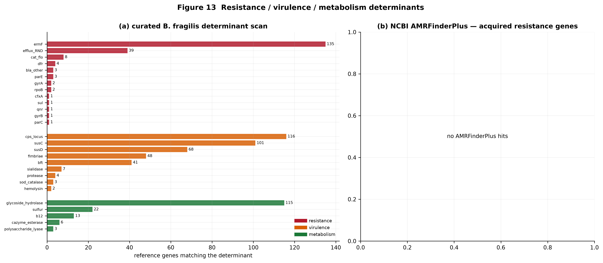

### 6.3 Metabolism and general function (COG)

The NCBI COG2020 database was searched with DIAMOND against both proteomes, which yields the standard COG functional-category profile without a proprietary pathway database. Categories C, E, F, G, H, I, P and Q are the metabolic categories.

* metabolic-category protein assignments — reference: 1192, query: 1202
* COG-annotated proteins — reference: 2783, query: 2821
* COG ids found in the query only: 2
* COG ids found in the reference only: 0

| COG_letter | COG_category | metabolism | reference_count | query_count | difference |
|---|---|---|---|---|---|
| J | Translation, ribosomal structure and biogenesis | no | 209 | 209 | +0 |
| A | RNA processing and modification | no | 0 | 0 | +0 |
| K | Transcription | no | 198 | 200 | +2 |
| L | Replication, recombination and repair | no | 172 | 182 | +10 |
| B | Chromatin structure and dynamics | no | 0 | 0 | +0 |
| D | Cell cycle control, cell division, chromosome partitioning | no | 50 | 50 | +0 |
| Y | Nuclear structure | no | 0 | 0 | +0 |
| V | Defense mechanisms | no | 144 | 147 | +3 |
| T | Signal transduction mechanisms | no | 187 | 189 | +2 |
| M | Cell wall/membrane/envelope biogenesis | no | 378 | 382 | +4 |
| N | Cell motility | no | 28 | 28 | +0 |
| Z | Cytoskeleton | no | 3 | 3 | +0 |
| W | Extracellular structures | no | 11 | 11 | +0 |
| U | Intracellular trafficking, secretion, and vesicular transport | no | 49 | 49 | +0 |
| O | Post-translational modification, protein turnover, chaperones | no | 136 | 136 | +0 |
| C | Energy production and conversion | yes | 155 | 155 | +0 |
| G | Carbohydrate transport and metabolism | yes | 244 | 248 | +4 |
| E | Amino acid transport and metabolism | yes | 188 | 189 | +1 |
| F | Nucleotide transport and metabolism | yes | 76 | 77 | +1 |
| H | Coenzyme transport and metabolism | yes | 179 | 179 | +0 |
| I | Lipid transport and metabolism | yes | 98 | 99 | +1 |
| P | Inorganic ion transport and metabolism | yes | 229 | 232 | +3 |
| Q | Secondary metabolites biosynthesis, transport and catabolism | yes | 23 | 23 | +0 |
| R | General function prediction only | no | 194 | 194 | +0 |
| S | Function unknown | no | 95 | 98 | +3 |

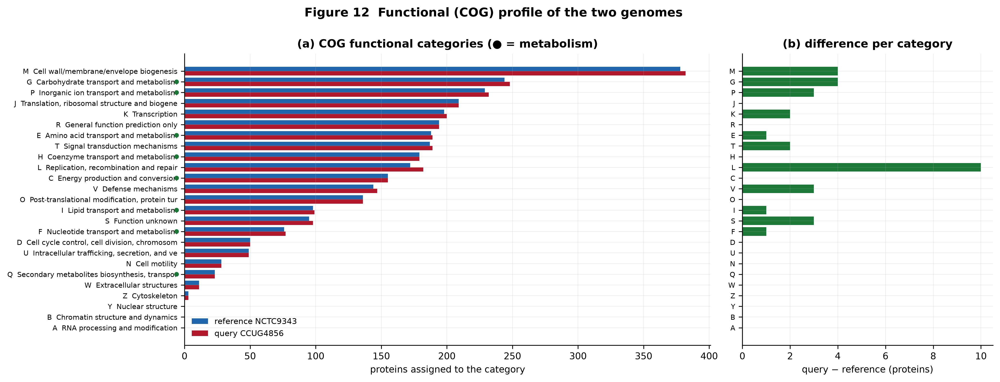

### 6.4 Plasmid

| property | value |
|---|---|
| orientation | reverse_complement |
| circular_rotation_offset_bp | 31410 |
| length_equal | True |
| identity_circular_pct | 100.0 |
| identity_direct_pct | 100.0 |
| circular_note | plasmids are circular: the two molecules are compared after allowing for an arbitrary rotation offset and both orientati |
| nucleotide_differences | 0 |
| reference_plasmid_genes | 47 |
| differences_in_genes | 0 |


The plasmid is **circular**, so the comparison allows for an arbitrary rotation offset and both orientations. Both plasmids are exactly 36560 bp and, after accounting for the deposited origin, are **identical in sequence** — the query copy is simply written from a different start point and on the opposite strand. There are no plasmid-encoded differences between the two strains.

The shared plasmid carries **47 annotated genes**, including **8** mobilisation / conjugative-transfer functions (TraG/VirB4 family ATPase, conjugative transposon protein TraK, conjugative transposon protein TraM, conjugative transposon protein TraN, plasmid mobilization protein, plasmid transfer protein, relaxase/mobilization nuclease domain-contai, type IV secretory system conjugative DNA tra). Because the plasmid is sequence-identical in both strains, this conjugative machinery — and therefore the plasmid's mobility potential — is shared.

### 6.5 Gene content

| metric | value |
|---|---|
| reference_cds | 4231 |
| query_cds | 4231 |
| reference_genes_absent_or_partial_in_query | 0 |
| query_genes_absent_or_partial_in_reference | 4231 |
| protein_identity_rows | 4160 |
| absent_threshold_pct | 80.0 |


## 7. Reproducing this analysis

```bash
source /home/cz/miniconda3/etc/profile.d/conda.sh
conda activate WGS
cd /home/cz/WGS
bash WGS.sh                # full pipeline, all steps
bash WGS.sh --steps 3,4    # only variant calling and annotation
bash WGS.sh --check         # verify the toolchain without running
```

Results are written under `result/01_qc` … `result/08_report`; every intermediate is under `work/`; per-step logs are under `logs/`.

## 8. Limitations and caveats

1. **Variant confirmation uses simulated reads.** They are exact copies of the query assembly and exist to demonstrate depth-supported confirmation and read-level QC; they cannot reveal errors that are already in the query assembly. Orthogonal confirmation (Sanger, Illumina, or long-read sequencing of the real strain) is still the gold standard.
2. **215 candidate differences in multi-copy repeats and at rearrangement breakpoints could not be resolved** and are listed explicitly in `03_variants/verified/variants_ambiguous.tsv` with the reason for each. Short reads cannot assign a difference to a specific copy of a repeated element; long-read or clone-level data would be needed. These are candidate differences, not confirmed ones.
3. **The 88 kb inversion is a sequence-orientation difference between the two deposited assemblies.** It is supported by a perfect reverse-complement alignment and the absence of a forward copy, but the biological consequence (e.g. whether it disrupts a gene) is inferred from the reference annotation.
4. **The origin shift is not a biological difference** and is reported separately so it is not mistaken for one.
5. **Bakta/Prokka de-novo annotation could not be completed** in this environment (Bakta's database is hosted on Zenodo, which was unreachable; Prokka has an unsatisfiable Perl dependency in this conda environment). Functional annotation therefore rests on the reference RefSeq annotation transferred through the alignment, plus AMRFinderPlus and COG2020, which is appropriate at 99.99 % identity but should be revisited if a Bakta database becomes available.
6. **The plasmid is identical to the reference plasmid in content** but deposited in the opposite orientation; see `06_extra/plasmid/`.

## 9. Software

```
run_date: 2026-10-12 17:27:35
host: gy-PR4865P-N-A
cores: 192
conda_env: WGS
conda_prefix: /home/cz/miniconda3/envs/WGS
--- tool versions ---
samtools: samtools 1.24
bcftools: bcftools 1.24
minimap2: 2.31-r1302
bwa: [main] unrecognized command '--version'
nucmer: 4.0.1
show-snps: show-snps: invalid option -- '-'
freebayes: version:  v1.3.10
dnadiff: dnadiff 
bakta: bakta 1.11.4
snpEff: Error        :	Unknown option '--version'
amrfinder: 4.2.7
quast.py: WARNING: Python locale settings can't be changed
seqkit: Error: unknown flag: --version
python3: Python 3.11.17
--- input checksums (md5) ---
ffd1964ca64888e9e1a5f3cde5989f2a  /home/cz/WGS/reference/unzipped/reference.fna
09b8821cba98f8ed58270395e711dc16  /home/cz/WGS/reference/unzipped/reference.gff
1bbc7a266064bcd8005cd6e7668a9f34  /home/cz/WGS/reference/unzipped/reference.faa
60566b193b3ee99b0f41420f5e4573df  /home/cz/WGS/seq/unzipped/query.fna
```
